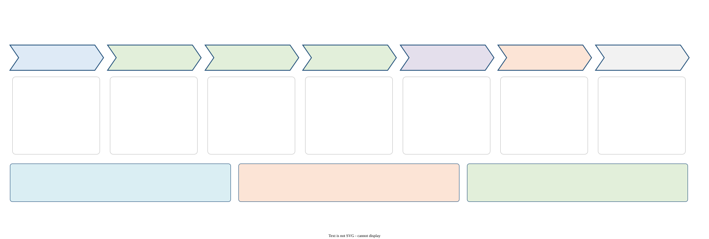
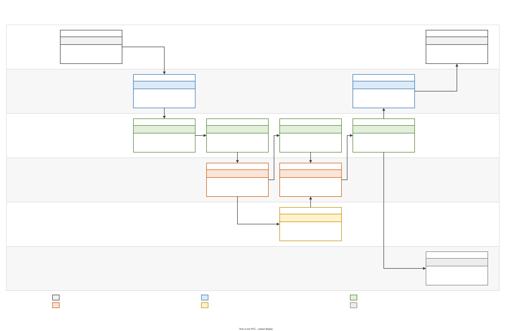
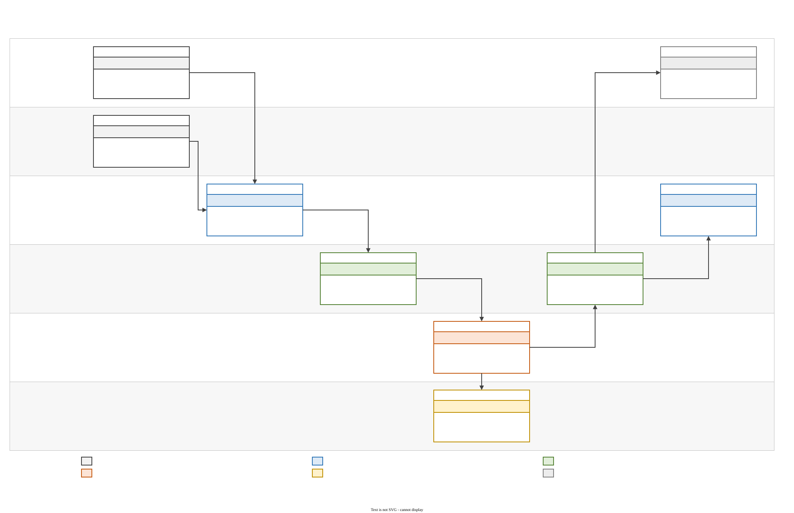
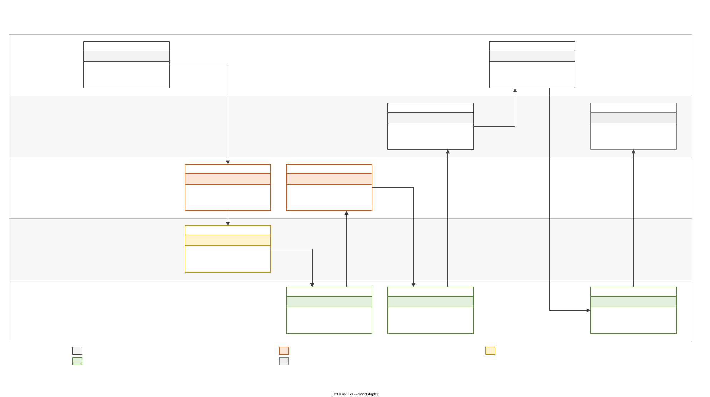
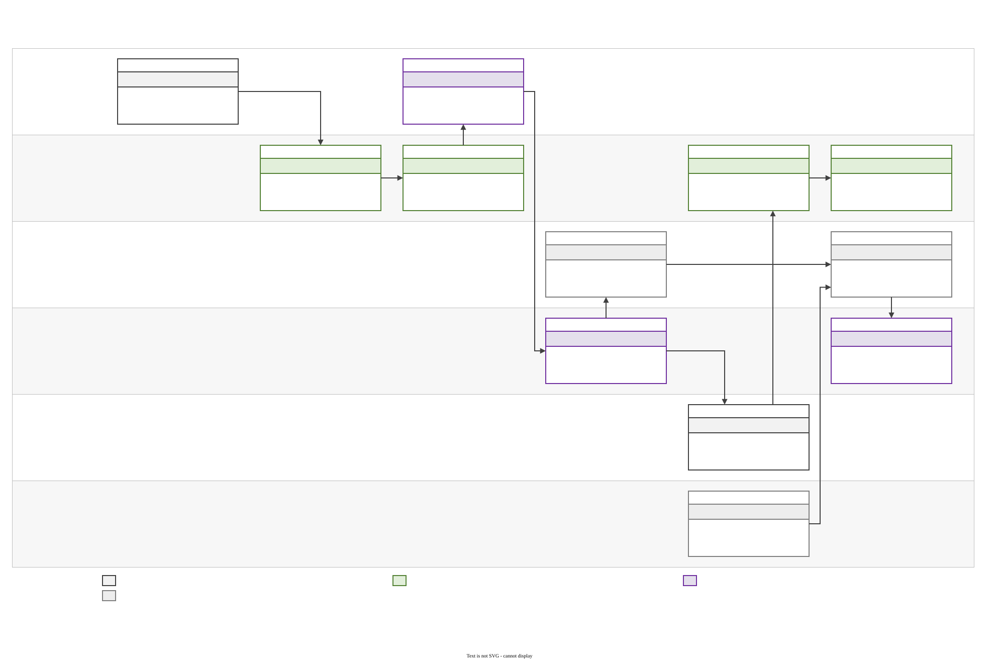
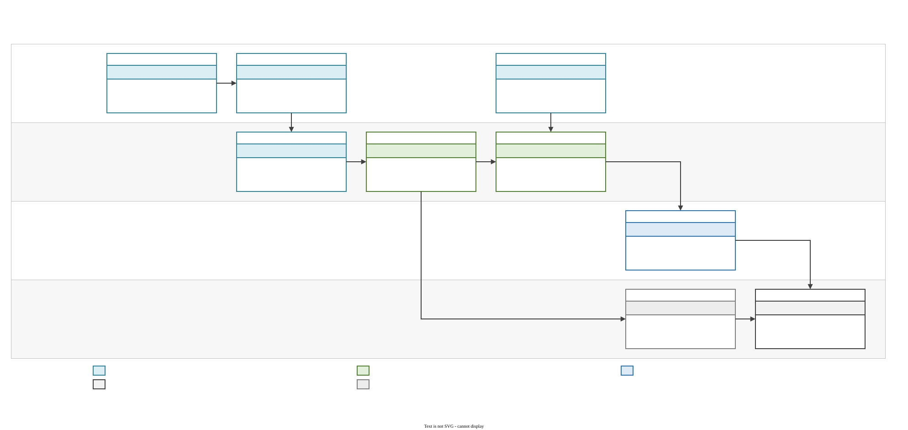

# Verksamhet: rmink i byggprojektet

Här finns diagram för verksamheten. De visar vem som gör vad, i vilket system, längs varje process. Hur tekniken är byggd finns i [../teknik](../teknik/README.md).

Kedjediagrammen följer samma mönster som kedjebilderna i Riksbyggen-projektet:
- **Rader:** en per roll, med rollen i fetstil och rollens system under.
- **Kolumner:** en per fas.
- **Kort:** varje steg är ett kort i tre delar, ett numrerat verb ("3 · tolkar"), en rubrikrad i systemets färg och korta rader om vad som händer.
- **Rött verb:** steget sker utanför rmink i dag, hos kommunen, på papper eller med e-post, eller är planerat.
- **Förklaring:** under kedjan står "Färg = system".

Diagrammen byggs av [`verksamhet.py`](../verksamhet.py) med stilen i [`kedja.py`](../kedja.py):

```
python docs/diagrams/build.py --export
```

## 0. Processkarta
Faserna från idé till relationshandling, vad som görs i varje fas, vilka roller som deltar och vilken kedja som visar detaljerna. Visar också de två sätten att använda rmink: på webben och i din egen Claude.



## 1. Från handskiss till ren ritning
Första varvet: skissen på plattan synkas, rmink läser strecken, Claude tolkar och slår upp krav, rmink rätar vinklar och kontrollerar mått. Revisionen kommer tillbaka till samma mapp med frågor att svara på.



## 2. Revisionsvarv: ändringar och svar
Markeringar och svar på SVAR-raderna blir en ny revision. Ändringar förs in, frågor stängs, och den förra revisionen arkiveras i Tidigare/.



## 3. Val mellan alternativ
Frågan "hur tjock?" eller "alternativ?" ger 2–4 lösningar med tjocklek, vikt, U-värde och kostnad. Valet görs med en bokstav på SVAR-raden.



## 4. Bygglov och byggprocessen
Från idéskiss via lovfrågan, ansökan, tekniskt samråd och utförande till slutbesked och relationshandling. Diagrammet visar vad rmink stöder och vad byggherren, kontrollansvarig, byggnadsnämnden, hantverkare och elinstallatör gör.



## 5. Bild eller PDF till reMarkable
Webbappen: välj fil, stil och penna, se förhandsbilden, konvertera till redigerbara pennstreck och skicka direkt till plattan.


