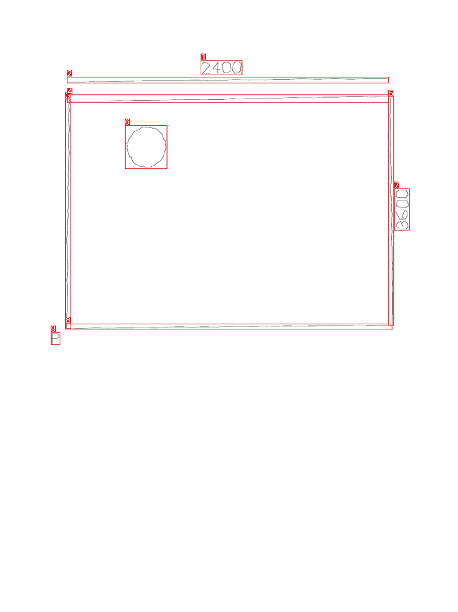
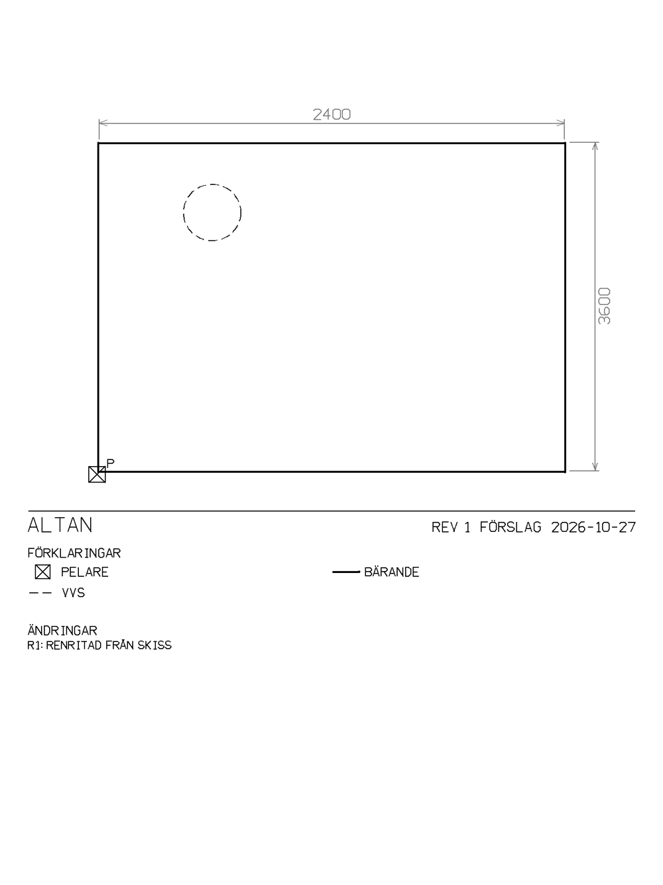
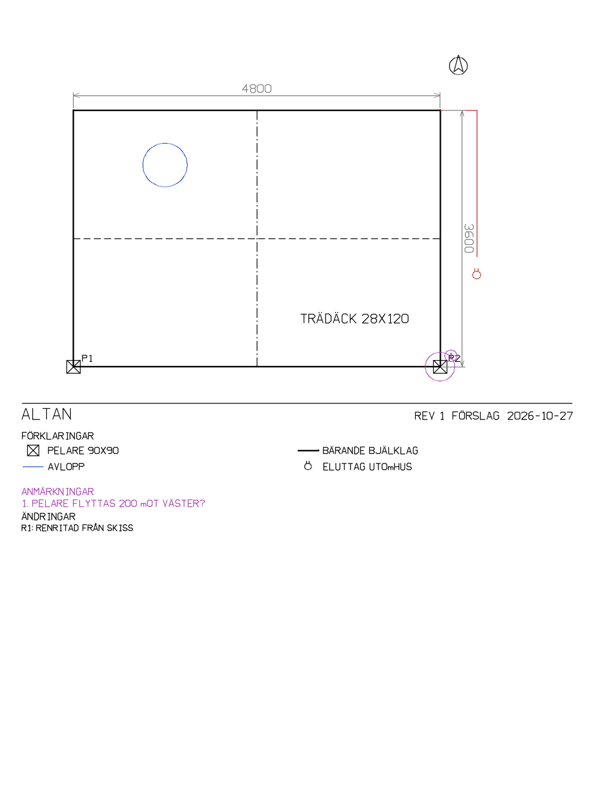

# Skiss → ren ritning (rmink "tvärtom")

Status: fas 1 (spike) är byggd: MCP-verktyg och CLI. Den är inte verifierad på en platta än.

## Bakgrund

Vid en demo (foto → bläck → skickat till plattan via molnet) föreslog en reMarkable-användare
motsatt riktning. Man skissar en 2D-ritning för hand på plattan: linjer, mått och vinklar,
symboler, pilar och en legend. Sedan får man tillbaka en renritad, tolkad version och förfinar
den i omgångar.

Ofta diskuteras en ritning en del i taget och fas för fas. Man ringar in, markerar, kompletterar
eller pekar på ett element som behöver kommenteras. Det ska fungera på rm2 och Paper Pure
(gråskala) och på Paper Pro och Move (färg), där kategorier och symboler gärna får färg både i
ritningen och i metadata.

## Scenarier

1. **Renritning.** Skissa en altan med handskrivna mått och be Claude "rita rent Altan".
   - Tillbaka kommer anteckningsboken *Altan r01* i mappen *rmink/Altan*: raka linjer, sammanfogade hörn, måttlinjer med
     pilar, versaltext, legend och revisionsruta.
   - Originalskissen ligger kvar som sida 2.
2. **Legenddriven symbolik.** En legend i skissen säger vad symbolerna och pilarna betyder.
   - Tolkningen använder den, och ritningen får standardsymboler med en ren förklaringsruta.
   - På Pro/Move har kategorierna färg: bärande svart, el röd, VVS blå, ändring grön,
     kommentar magenta.
   - På rm2/Pure skiljs de åt med linjetyp (heldragen, streckad, prickad, streckprickad)
     och tjocklek.
3. **Granskningsrunda.** Man ritar på *r1*, helst i lagret *Kommentarer*:
   - ringar in en pelare
   - skriver "flytta 200?"
   - kryssar en vägg

   Nästa körning hämtar bara de **nya** strecken och kopplar varje markering till ett
   element-ID. Tydliga ändringar görs direkt. Frågor blir numrerade öppna anmärkningar i
   *r2*, och ändringsloggen växer.
4. **Faser och nedslag** (senare). Varje revision har fas och datum, t.ex. Förslag → Granskning
   → Beslut. Ett nedslag blir en detaljvy av ett element på en egen sida, där man skissar vidare.
5. **Varianter** (senare). Alternativ A och B från samma modell, som sidor att markera och välja
   mellan.
6. **Pappersskiss** (senare). Ett foto av en pappersskiss går in i samma tolkning, via
   kameraknappen i webbappen.
7. **Export.** Den rena sidan som SVG (finns), senare PDF och DXF.

## Exempel

En påhittad testskiss, en altan med darriga linjer, handskrivna mått och en cirkel, som körts
genom hela flödet.

**1. Skissen som Claude ser den.** Varje grupp av streck har en ruta och ett nummer. Långa streck
har anpassats till linjer och cirklar. Siffrorna "2400" och "3600" blev egna textgrupper.



**2. Renritningen (r1) på rm2.** Linjerna är raka och hörnen ihopsatta. Måttlinjerna har pilar
och lodräta mått läses nedifrån och upp. Legend och revisionsruta är skapade automatiskt. VVS
ritas streckat eftersom rm2 saknar färg.

Måttkontrollen flaggade att "2400" och "3600" inte stämmer med skissens proportioner. Det är
korrekt, för testskissen är fel ritad med flit.



**3. Samma typ av ritning på Paper Pro.** Det här är ett handskrivet modellexempel, inte tolkat
från skissen ovan. Kategorierna har färg: VVS blå, el röd. Den öppna anmärkningen "1" ringar in
pelaren P2 och listas under ANMÄRKNINGAR.



Anteckningsboken från steg 2 finns som [altan-r1.rmdoc](images/sketch-to-drawing/altan-r1.rmdoc):
renritningen på sidan 1 och originalskissen på sidan 2. Lägg den på plattan för att se hur den
ser ut i verkligheten.

## Hur det fungerar

Detaljerade diagram över varvet, verktygen, mapparna och molnet finns i [`docs/diagrams/`](diagrams/README.md) (diagram 3–6 och 8).

```
platta ─sync─▶ reMarkable Cloud ─rmapi get─▶ ingest/rm.py (streck, lager, CRDT-id)
                                                 │
                                drawing/fit.py: gruppering, linje/cirkel/båge/polylinje,
                                                numrerad översiktsbild
                                                 │
        Claude (MCP) ◀── bild + grupp-JSON ──────┘   semantik: vägg, mått, symbol,
             │                                        legend, markering
             ▼
        Drawing (JSON) ─▶ rectify + måttkontroll ─▶ drawing/render.py ─▶ "<namn> r<N>.rmdoc"
             │                                                            │
             └─ sparas i ~/.config/rmink/drawings/ ◀── nästa runda ───────┘ rmapi put ─▶ platta
```

- **Claude står för semantiken:** läser handskrift, avgör vad som är mått och vad varje symbol
  betyder, och kopplar markeringar till element.
- **rmink står för geometrin:** anpassning, uppräkning, rendering.
- Claude refererar till grupper och återanvänder deras anpassade koordinater, i stället för att
  gissa koordinater ur bilden.
- Tolkningen kostar inget för rmink: den körs i användarens egen Claude.

### Delarna

| Del | Fil | Gör |
|---|---|---|
| Läsning | `ingest/rm.py` | .rmdoc/.rm → `Document`, med lagernamn och `(author, counter)`-id per streck |
| Lager | `writer/rm_v6.py`, `package/rmdoc.py` | flera lager per sida (ett lager ger samma fil som förut) |
| Moln | `cloud.py` | `ls`, `get`, `put`; token i `~/.config/rmink/cloud.toml` för CLI/MCP |
| Anpassning | `drawing/fit.py` | grupperar streck och anpassar former (se nedan); ger en numrerad bild |
| Modell | `drawing/model.py` | `Drawing`: element, mått, vinkelmått, symboler, anmärkningar, legend, logg, kategorier |
| Rendering | `drawing/render.py`, `font.py`, `symbols.py` | rena fineliner-streck, versalfont, 33 symboler, titelblock, SVG |
| Arbetsflöde | `drawing/workflow.py` | `read_sketch`, `rectify`, `check_dimensions` (längder och vinklar), `measure`, `build_revision` och lagring |
| Räkning | `calc.py` | säker aritmetik: trigonometri i grader, trianglar, lutning, area, volym, vikt, U-värde, mängder, mängdlära |

Detaljer:
- **Anpassning:** små streck nära varandra blir en grupp (text, pilspetsar, små symboler). Långa
  streck anpassas till linje, cirkel, båge eller polylinje.
- **Rendering:** färg på Pro/Move, linjetyp på rm2/Pure.
- **Alternativ:** frågar man "hur tjock?" eller "alternativ?" läggs 2–4 lösningar på en egen sida
  efter ritningen (`render_alternatives`).
  - Varje lösning visas med en liten skrafferad sektion, lagertexter, tjocklek, uppskattat U-värde,
    vikt per m², kostnadsnivå samt för- och nackdelar.
  - Man väljer genom att skriva bokstaven på SVAR-raden. Nästa varv ritar in valet.
  - Lösningarna kommer från varianterna i `assemblies.toml`. Konstruktören bestämmer tjocklek och
    armering, och energiberäkningen avgör U-värdet.
- **Enheter:** varje mått ritas med sin enhet (`4800 mm`), och ritningshuvudet anger `Mått i mm`.
  Med `show_units: false` står enheten bara i ritningshuvudet, som på många standardritningar.
- **Räta vinklar:** en handskiss ritas på fri hand, men väggar möts i 90° om ingen skriven vinkel
  säger annat. `rectify` rätar linjer som ligger inom 12° från vågrätt eller lodrätt, och sluter
  hörn där linjerna går för långt eller slutar för tidigt. En linje som ska luta mindre än 12°,
  som en takfot eller en ramp, behöver ett vinkelmått i någon av sina ändar för att behålla sin
  vinkel. Innan rundan sparar granskar Claude förhandsbilden: väggarna ska vara räta, lådorna
  rektanglar och öppningarna ligga längs sina väggar.
- **Vinklar och räkning:** ett vinkelmått (`AngleDimension`) ritas som en båge med pilar mellan
  två ben. Gradtalet skrivs som `38,7°`. Lämnas texten tom skrivs den ritade vinkeln.
  - Skriver man "visa vinklarna" på ritningen tar Claude hörnens vinklar från `measure` och
    sätter ut dem.
  - Alla tal kommer från kod, aldrig ur huvudet:
    - `measure` ger längd, area och hörnvinklar ur geometrin. Skalan tas från de skrivna måtten.
    - `calculate` räknar uttryck: `hypot(3600, 1200)`, `slope(1200, 3600)` → 18,4° = 1:3 = 33 %,
      `triangle(a, b, c)`, `count(4800, 600)` → 9 reglar, `weight(0,2 m³, "betong")`.
      Vikten bygger på ungefärliga densiteter i `materials.toml`.
  - `check_dimensions` jämför skrivna vinklar med ritningen. Skiljer de mer än 2° blir det en
    fråga.

### Gränssnitt

- **MCP:** `cloud_connect`, `cloud_list`, `read_sketch`, `drawing_reference`,
  `lookup_knowledge`, `calculate`, `measure_drawing`, `render_drawing_preview`, `save_revision`,
  `get_drawing`
- **CLI:** `rmink cloud connect|ls|get|put`, `rmink sketch DOC --overlay groups.png`,
  `rmink draw drawing.json [--svg] [--send]`, `rmink round NAMN|DOC`
- **Webb:** `/rounds` (bara för ägaren): ritningskort med **Kör nästa varv**, nya skisser i
  *rmink* och en bläddrare som reserv

### Revisioner och markeringar

`build_revision` skriver revisionens sida med två lager:
- `Ritning rN` med den rena ritningen
- ett tomt lager `Kommentarer` för användarens markeringar

Den sparar också id:n på strecken rmink skrev (`sketch.written_ids`). I nästa runda filtrerar
`read_sketch(..., since_drawing=namn)` bort de strecken. Kvar blir bara användarens markeringar.

Varje öppen anmärkning listas under ANMÄRKNINGAR med en rad märkt SVAR. Det man skriver på raden
räknas som svaret på just den frågan. Svar bredvid ringen på ritningen gäller också.

### Mappar och namn på plattan

`send_revision` lägger varje revision i ritningens egen mapp:

```
rmink/
  Garage                  ← lös anteckningsbok = ny skiss som väntar på varv 1
  Altan/
    Altan r03 · 2 frågor  ← den enda att rita på
    Tidigare/
      Altan r00 skiss     ← originalskissen
      Altan r01
      Altan r02 · 1 fråga
```

- Namnet är `<ritning> r<NN>`. Två siffror gör att namnordning blir tidsordning. `· N frågor`
  läggs till när revisionen har öppna anmärkningar, så man ser vilka som väntar på svar.
- Datumet står i namnrutan bredvid REV.
- Mappen *rmink/Altan* skapas i första varvet. Skissen döps då om till *Altan r00 skiss*, eftersom
  rmapi hittar mappar och dokument på namn och mappen ska heta som skissen.
- Efter varje varv flyttas anteckningsboken som lästes till *Tidigare*. rmink flyttar bara det som
  ligger i *rmink*. Skisser på andra ställen ligger kvar.
- Den sparade ritningen minns var senaste revisionen hamnade (`sketch.sent_as`). Därför räcker
  `rmink round Altan`, och **Kör nästa varv** på /rounds behöver ingen filväljare.

### Måttkontroll

`check_dimensions` räknar fram en gemensam skala ur de skrivna måtten och flaggar mått som
avviker mer än 10 %. Det är ofta en feltolkad siffra, eller ett riktigt fel i skissen som är
värt att fråga om.

## Öppna frågor (verifiera på platta)

- [ ] Behåller plattan rmink:s CRDT-id:n och lagernamn när användaren ritar och synkar?
  - Antagandet är ja: plattan lägger till sin egen författare i stället för att skriva om befintliga streck.
  - Om inte, behövs en reservlösning: geometrisk diff mot det som skrevs.
- [ ] Visas lagret *Kommentarer* och kan man välja det? Syns *Ritning rN* som ett eget lager som går att dölja?
- [ ] Har sidor högre än skärmen (titelblocket under ritningen) rätt rullning på alla modeller?
- [ ] Hur bra läser Claude handskrivna mått som "2400", "45°" och "Ø110" ur översiktsbilden? Testa med riktiga skisser.
- [ ] Klarar namn med `·` och å/ä/ö rmapi och synken till plattan? Hur sorterar plattan *Tidigare*?

## Nästa steg

1. Testa på rm2 med en riktig skiss från användaren som föreslog idén, och fyll i de öppna frågorna.
2. Bestäm skiss-konventioner tillsammans med hen:
   - vilka symboler och pilar
   - vad en ring respektive ett kryss betyder
   - om färgade pennor på Pro ska betyda kategori redan i skissen
3. Fas 2 (webben):
   - knappen "Rita rent" i webbappen, med användarens egen API-nyckel
   - foto av pappersskiss
4. Varianter, nedslag/detaljvyer, PDF/DXF-export.
